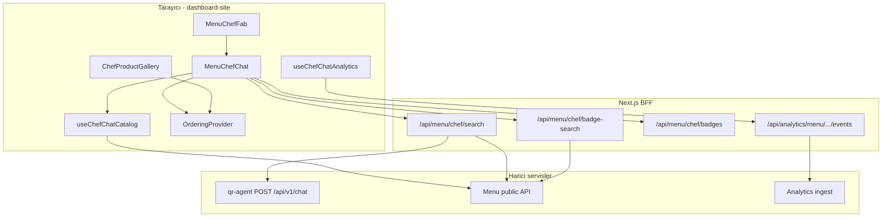

# Şef sohbet ve ürün öneri akışı

Bu doküman **şu anki (main)** davranışı özetler ve sohbet + ürün önerisini iyileştirmek için önerilen yol haritasını içerir.

İlgili teknik referanslar:

- Agent sözleşmesi: [`chef-agent-contract.md`](./chef-agent-contract.md)
- Ölçüm / KPI: [`chef-funnel-kpi.md`](./chef-funnel-kpi.md)

---

## 1. Mimari özet

| Katman | Sorumluluk |
|--------|------------|
| **UI** | Sohbet, kompakt ürün kartları, galeri, sepet koçu, cross-sell şeridi |
| **BFF** | Katalog, agent çağrısı, `productIds` filtreleme/sıralama, kısa `reply` |
| **qr-agent** | Doğal dil anlama, `reply` + `productIds` (max 6) |
| **Ölçüm** | `CHEF_*` event’leri → menu analytics |

**Önemli ürün kararı:** Menü kombinasyonu (yemek+içecek+tatlı paketi) **kapalı**. API her zaman `menuSuggestions: []` döner; UI menü paketi göstermez. Sadece **tek ürün** kartları önerilir.

---

## 2. Kullanıcı yolculukları (şu an)

### 2.1 Sohbeti açma

1. Misafir menü sayfasında **Şefe danış** FAB’ına basar (`MenuChefFab`).
2. Tam ekran `MenuChefChat` açılır; `CHEF_CHAT_OPEN` event’i gönderilir.
3. Paralel olarak `fetchAllPublicMenuProductsClient` ile tüm public ürünler belleğe alınır (`useChefChatCatalog`).
4. Header’da katalog durumu: yükleniyor / hazır / hata.
5. Opsiyonel: `/api/menu/chef/badges` ile karşılama metni welcome mesajına yazılır.
6. Oturum `sessionStorage` benzeri bellek içi map’te tutulur (`chef-chat-session`).

Sohbet, katalog **hazır olmadan** öneri isteği göndermez (`catalogReady` gate).

### 2.2 Serbest metin sorusu

1. Misafir input’a yazıp gönderir → `runAgentSearch(text, "default")`.
2. `buildChefAgentContextMessage` sepet / mod bağlamını `message` alanına koyar; kullanıcı cümlesi **`userQuery`** olarak aynen gider (normalize yok).
3. `POST /api/menu/chef/search` body: `userQuery`, `message`, `conversationId`, `menuProducts`, `cartProductIds`, …
4. BFF agent’a katalog + `userQuery` + bağlam gönderir; yanıt `chefAgentChatResponseSchema` ile doğrulanır.
5. Agent `reply` + `productIds` döner (birincil öneri kaynağı).
6. BFF: agent seçimini korur; boşsa ham `userQuery` ile katalog yedek araması; sonra `rankChefRecommendations`.
7. Ürünler hydrate edilir; `mergeReplyWithPersuasion` kısa metin bırakır.
8. UI: assistant balonu + **Öneriler** altında yatay kompakt kartlar (`MenuChefProductCardGrid`).
9. Uzun ürün listesi metni bastırılır → `assistantCaptionForProductReply`.

### 2.3 “Öneri” butonu (genel)

1. `runAgentSearch(..., "general")` — sepete özel prefix: genel ürün, menü paketi yok.
2. Kullanıcı mesajı balonda **Genel öneri** olarak görünür.

### 2.4 Hızlı rozetler (welcome / upsell)

| Kaynak | API | Davranış |
|--------|-----|----------|
| Konfig rozetleri (`chef_recommended`, `popular`, kategori…) | `badge-search` | Kural/filtre ile ürün listesi; agent yok |
| Sepet koçu upsell (`upsell_food`, `upsell_drink`, `upsell_dessert`) | `badge-search` (synthetic badge) | `menuRole` filtresi ile içecek/tatlı/yemek |

Rozet tıklanınca kullanıcı mesajı rozet etiketi olur; yanıt yine **ürün kartları**.

### 2.5 Sepet koçu (kural tabanlı)

1. Sepet değişince `MenuChefCartCoachEffect` eksik kursları hesaplar (`food` / `drink` / `dessert` heuristik).
2. Sohbete assistant mesajı + **Ana yemek öner** / **Serin içecek öner** / **Tatlı öner** rozetleri eklenir.
3. Cross-sell gösterildikten sonra ~5 sn coach mesajı bastırılır (`shouldSuppressCartCoach`).

### 2.6 Sepet değişince arka plan agent

**Kapalı (Faz A1):** Sepet değişiminde agent çağrısı yok. Sepet için yalnızca **sepet koçu** (kural tabanlı mesaj + upsell rozetleri) çalışır.

### 2.7 Ürün kartı → galeri → sepete ekle

1. Karta tık → `CHEF_PRODUCT_CARD_CLICK` → `ChefProductGallery` tam ekran detay.
2. **Sepete ekle** → `beginAddProduct(..., { openCart: false })` — **sepet paneli otomatik açılmaz** (şef akışı).
3. Başarılı eklemede “Sepete eklendi” + isteğe bağlı **Menünü tamamla** cross-sell (1–2 kompakt kart, pairing + eksik kurs).
4. Cross-sell’den ekleme de `openCart: false`.
5. Sepeti görmek için: header **Sepet** ikonu veya **Siparişi tamamla** (soldan `CartSheet`).

Normal menü template’lerinde `beginAddProduct` varsayılanı hâlâ sepeti açar; sadece şef bileşenleri `openCart: false` kullanır.

### 2.8 Siparişi tamamlama

1. `CartSheet` (şef açıkken soldan) → not, adet, `ORDER_SUBMITTED` (genel ordering akışı).

---

## 3. Veri modeli (mesaj)

Assistant mesajı (`ChefChatMessage`):

- `text` — kısa caption
- `products?` — `ChefProductItem[]` (kartlar için)
- `menuSuggestions?` — tip hâlâ var; **yeni yanıtlarda doldurulmuyor**
- `upsellBadges?` — sepet koçu
- `searchComplete?` — debug (Storybook / flag)
- `turnId?` — DB’deki sohbet turu (agent yanıtı)
- `feedback?` — `like` | `dislike` (misafir oyu, UI + API)
- `showRecommendationFeedback?` — öneri balonunda beğeni satırı
- `showEmptyStateBadges?` — ürün yoksa hazır filtre rozetleri

### 3.1 Öneri beğenisi

1. Ürün kartlı (veya boş) öneri balonunda **beğen / beğenme** ikonları.
2. Tıklanınca `CHEF_RECOMMENDATION_FEEDBACK` analytics + isteğe bağlı `POST /api/menu/chef/turn-feedback` (`turnId` varsa).
3. Backend: `PATCH .../chef-chat/turns/{turnId}/feedback` → `LIKE` / `DISLIKE`.

---

## 4. Kalite katmanları (nerede ne karar veriliyor)

| Aşama | Ne yapılıyor |
|-------|----------------|
| **Prompt prefix** | Mod: default / general / cart; kısa yanıt, max 6 ID, menü paketi yok |
| **Agent (qr-agent)** | Semantik eşleme, diyet/alerjen (prompt’a bağlı) |
| **BFF filter** | Sepetteki ID’leri çıkar |
| **BFF rank** | Şef önerisi, rating, kategori başına max 2, max 6 ürün |
| **UI caption** | Uzun liste metnini gizle, kart göster |
| **badge-search** | Rozet filtresi (popüler, şef, rol) — LLM yok |
| **Cross-sell** | Deterministik `pickCrossSellProducts` (pairing + eksik kurs) |

---

## 5. Bilinen sınırlamalar

1. **Agent bu repoda değil** — kalite tavanı qr-agent prompt + model ile sınırlı; BFF sadece son işler.
2. **Kurs sınıflandırması** isim/kategori regex (`classifyMenuProductRole`) — hatalı sınıflandırma cross-sell ve koçu etkiler.
3. **Rozet/badge önerileri** DB turu oluşturmaz; beğeni yalnızca analytics’e düşer (`turnId` yok).
4. **Analytics backend** yeni `CHEF_*` tiplerini reddedebilir → BFF 204 + log fallback.
5. **Ürün seçenekleri** (options sheet) şeften eklenirse hâlâ options sheet açılır; onayda sepet global davranışı açabilir (options path ayrı).
6. **Konuşma bağlamı** sadece `conversationId` + agent tarafında; client’ta tam transcript agent’a her seferinde gitmiyor (sadece son `message` + prefix).

---

## 6. İyileştirme planı

Öncelik: ölçüme dayalı, küçük PR’lar. Tahmini fazlar.

### Faz A — Gürültüyü azalt, akışı netleştir (1–2 hafta)

| # | İş | Beklenen etki |
|---|-----|----------------|
| A1 | Sepet debounce agent kapatıldı | ✅ |
| A2 | Koç mesajı + upsell rozetlerini tek balonda birleştir; aynı sepet imzası için tekrar etme | ✅ |
| A3 | Öneri yoksa empty state + hazır rozetler | ✅ |
| A4 | Dashboard’da chef funnel raporu (`ChefFunnelReportSection`) | ✅ (sampleJourneys) |
| A5 | Öneri like/dislike + turn feedback API | ✅ (backend endpoint gerekli) |

### Faz B — Öneri kalitesi (2–4 hafta, qr-agent + BFF)

| # | İş | Beklenen etki |
|---|-----|----------------|
| B1 | qr-agent: [`chef-agent-contract.md`](./chef-agent-contract.md) + golden set CI | ✅ `npm run test:chef-golden` (BFF offline) |
| B2 | Agent’a son N tur özet transcript (token limitli) | ✅ `conversationTranscript` |
| B3 | BFF’de diyet/alerjen hard filter (kullanıcı mesajında keyword + ürün allergens) | ✅ |
| B4 | `rankChefRecommendations`: stok/`available`, fiyat bandı, session dedup, geçmiş sipariş boost | ✅ |
| B5 | badge-search hybrid (`CHEF_BADGE_HYBRID_AGENT`) | ✅ |

### Faz C — UX ve dönüşüm (2–3 hafta)

| # | İş | Beklenen etki |
|---|-----|----------------|
| C1 | Kartlarda tek tık “Sepete ekle” (`NEXT_PUBLIC_CHEF_CARD_QUICK_ADD`) | ✅ |
| C2 | Cross-sell: env ile 1 vs 2 kart A/B + `crossSellVariant` metadata | ✅ |
| C3 | Sepete ek sonrası toast + “Sepete git” | ✅ |
| C4 | Streaming reply (`/api/menu/chef/search/stream` SSE) | ✅ |

### Faz D — Kişiselleştirme

- Saat dilimi / öğün (`mealPeriod` prefix) — ✅
- Geçmiş sipariş ürün id’leri (`priorOrderProductIds`) — ✅ (giriş yapmış misafir)
- Menü locale (`tr` / `en` / …) agent isteğinde — ✅

---

## 7. Önerilen KPI’lar (karar için)

| Metrik | Formül / event |
|--------|----------------|
| Öneri → sepet | `CHEF_PRODUCT_ADD` / `CHEF_RECOMMENDATION_SHOWN` |
| Kart tıklama | `CHEF_PRODUCT_CARD_CLICK` / `CHEF_RECOMMENDATION_SHOWN` |
| Cross-sell kabul | `CHEF_CROSS_SELL_ADD` / `CHEF_CROSS_SELL_SHOWN` |
| Uçtan uca | `ORDER_SUBMITTED` / `CHEF_CHAT_OPEN` |
| Agent gecikme | BFF log `chef_bff_timing` p95 |

Hedef örnek (staging’de 2 hafta veri sonrası belirlenir): öneri→sepet %15+, cross-sell add %25+.

---

## 8. Hemen yapılabilecek 3 küçük PR fikri

1. **Sepet agent sessiz mod** — sadece kullanıcı “Öneri” veya yazdığında yeni balon; sepet değişiminde sadece koç.
2. **Session dedup** — aynı `productId` son 3 assistant mesajında tekrar gösterilmez.
3. **qr-agent PR** — system prompt’a Türkçe few-shot + `cartProductIds` structured kullanımı.

---

## 9. Dosya haritası (geliştirici)

| Alan | Dosyalar |
|------|----------|
| Sohbet UI | `src/components/menu-templates/chef/MenuChefChat.tsx` |
| Katalog | `use-chef-chat-catalog.ts` |
| Agent mesaj | `src/lib/chef/chef-agent-message.ts` |
| BFF search | `src/app/api/menu/chef/search/route.ts` |
| BFF badge | `src/app/api/menu/chef/badge-search/route.ts` |
| Sıralama | `src/lib/chef/rank-chef-recommendations.ts` |
| Cross-sell | `pick-cross-sell-products.ts`, `MenuChefProductDetailPane.tsx` |
| Sepet koçu | `chef-cart-coach.ts`, `MenuChefCartCoachEffect.tsx` |
| Ölçüm | `use-chef-chat-analytics.ts`, `menu-analytics.ts` |
| Sepet açma | `ordering-context.tsx` (`openCart` flag) |

---

*Son güncelleme: main branch — menü paketi kapalı, şef sepete ekte `openCart: false`.*
